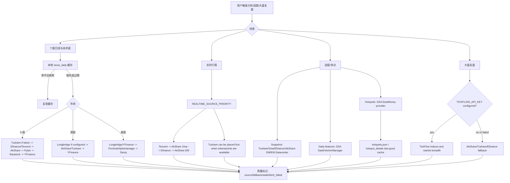
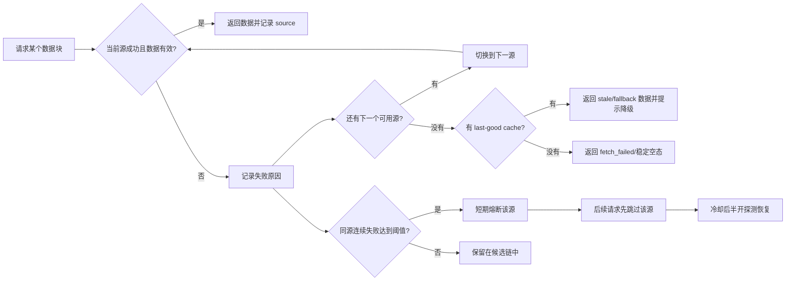
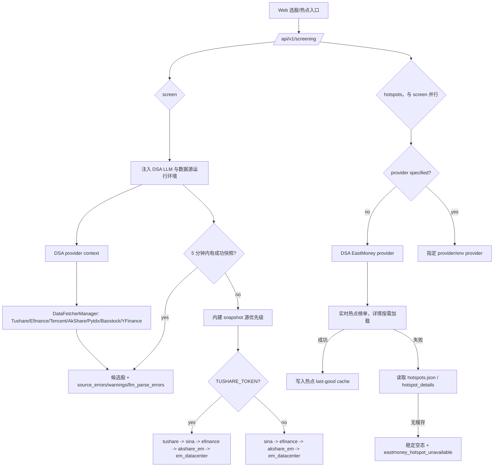

# 数据源稳定性与故障处理图示

本文面向用户、部署者和维护者，说明 DSA 已接入的数据源如何参与分析、选股和大盘复盘，以及当数据源失败时系统会怎么降级。

核心原则：先用项目已经接入并验证过的数据源，把失败路径讲清楚；新增外部数据源应放在第二阶段，避免先扩大维护面。

## B1→B5：严格当前来源的持久化权利 Gate（2026-10-15）

源数据的 `provider_identity`、`qfq/hfq/raw`、K线完成状态、`content_sha256`、`available_at` 与 `pit_eligible` 都**不能代替**对数据使用、持久存储、训练、再分发的独立许可。本轮没有得到对BaoStock数据存储/训练范围的可核授权，任何第三方开源客户端许可也不等同于行情数据许可。

当前唯一 DSA `PredictionLedgerService.persist` 对 `method_execution_receipt_policy=REQUIRED` 的严格新研究实行 `LAWFULLY_REJECTED/SOURCE_STORAGE_RIGHTS_NOT_ADMITTED`，在调用 Ledger Repo 写入之前退出，即使输入含有自称 `data_rights.storage=GRANTED` 的未核文本也不得绕过。历史冻结Ledger仍可读取和审计，但其既有语义 `pit_eligible=True` **不升级**为新的版权许可或可训练身份。此门禁只防止尚未合法准入的数据进入**新的严格研究Ledger**；不能声称历史账本所有权利已经重审，也不能声称所有源数据读写通道已经全局闭合。

只有将来源、许可颁发主体、版本/条款、允许动作及权利生效时点同已完成bar、币种/数量单位、复权修订vintage、`observed_at/available_at` 一起独立验证并纳入现有权威后，才可按显式后续Gate修改该拒绝条件，复验写后读回；不因使用者在运行时自行添加 `GRANTED` 字样或旧样本 PIT 标记而晋升。

### 2026-10-16：首次写库边界（未发布的 DSA 本地工作树）

在既有 `DatabaseManager.save_daily_data` 与 `save_analysis_history` 首次数据库写入点，实行同一拒绝规则：未独立准入的真实第三方行情、市场复盘、AnalysisHistory 原文/上下文以及由它触发的 PENDING Journal，不得因为无严格方法标记、`data_source=test`、进程变量 `PYTEST_CURRENT_TEST`、自行声明 `GRANTED` 或类型化价格来源身份而落入业务数据库。类型化 BaoStock 身份与伪造的 TestData 来源冲突时必须拒绝，不能将原身份清空后继续 UPSERT。

历史数据只读审计不受新增写入准入规则授权改变。原生合成测试仅可在实际 `sqlite:///:memory:` 或 OS 临时目录中的独立 SQLite 目的地、合成来源/合法身份匹配时进行数据库正向写入读回；这**不是**数据供应商存储/训练/再分发许可，不可用来形成生产历史、PIT 或模型样本，也不是恶意擦除全部来源元数据后的绝对防伪证明。真实生产目的地不因测试运行变量而获许可。已确认的外部源正向入库仍为 NOT_ADMITTED，等待来源方精确授予、单位、复权修订版本与可得时点的独立证据。

原生反例：非严格 MarketReview 历史、伪造 pytest+test 来源、BaoStock 类型化身份被 TestData 标签洗白均先 RED 后拒绝；合法临时 StockDaily 和 AnalysisHistory 插入/读回留存。代码经过局部 Storage/GetLatest 与已确认多周期方法回归；全部 API/正式报告/收件客户端、真实许可的写后读回和历史 PIT 仍独立 OPEN。正式完整 Report 的 Email 必须、Telegram 可选合同未改；静态 V2.5 原件未改。

## B5 七周期方法窗口与受限交易日历（2026-10-16）

当前 `StockAnalysisPipeline._current_daily_window_plan` 使用现有 `compile_method_window_policy_view` 和交易所日历生成一个真实日线请求起点；月／周／日各自的指标计算仍以本周期完成bar、实际数据内容及真实来源时点为准。原有基础获取需求（月／周各40根、日线268根）保留为 `source_only_timeframe_required_bars`，绝不将月／周40根均线或结构上下文误称MACD、RSI递归就绪。

只有原 Registry 将 `MTF_MOMENTUM_CONTEXT` 路由到月／周时，现有 MACD 与 RSI 实际Owner分别提出多起点比较目标140、268根本周期K线。计划逐组件测试交易所日历是否有足够历史：能实现的计入实际 `timeframe_required_bars` 与 `start_date`，不可实现者记 `CALENDAR_HISTORY_OUT_OF_RANGE`，保留较短但合法的均线／价格结构历史与独立缺口。此状态仅表示**日线抓取时间范围规划可行**，不表示交易数据实际返回足够、递归数值收敛、历史PIT、供应商存储许可或策略行动许可。

对2026-10-12的XSHG规划，周线可计划268根、月线可计划140根、日线保留268根；月线268根需要追溯到2004年6月，而当前运行时XSHG日历从2006-10-16起，必须保留月线 RSI 未覆盖缺口。真实供应商数据、复权vintage、分钟成交量/额单位和存储/训练权利仍须各自独立验证。历史缓存恰好含当日bar并不能证明前述扩展窗口已被完整覆盖。当前 CN Stock Analysis 的 `fetch_and_save_stock_data` 仅在既有SQLite行的日期集精确覆盖该窗口内全部真实交易所会话时才可跳过重新取数；只有最新一根日K或中间缺一日都不可称完整窗口。出于最小兼容范围，原P0与非CN缓存早退保持既有独立历史合同，尚未按本CN Gate自动获得七周期窗口准入。缓存日期完整本身也不等于许可合法、复权一致、数值稳定或PIT。

## 2026-10-16 B5主线实证—机器图、父目标多级对齐、Root-Cause / Role Review（本地未发布）

**决策性质：** 这是唯一 `daily_stock_analysis / DSA` 的实施证据及既有Owner文档闭环，不是新第九个Project Source、策略/模型晋升、数据许可证或独立治理服务。Current 01/05仍为物理唯一v3.468，后继具体阶段由更近exact repo+本次实测决定。Git本地origin为 `https://github.com/leeningzzu/dsa-market-research.git`，HEAD `9593c76795e14b0125450bfc8fafcc5856fc351c`、tree `d92db4903197cb91df430b20060bf7818fe19aa5`，当前40 WIP保护；本次远端 `git ls-remote origin refs/heads/main` 返回连接重置，故REMOTE_MAIN_CURRENTNESS=NOT_PROVEN，不能提交、推送、开PR或声称GitHub CI为本轮PASS。

### 证据链：原图≠投影≠真实执行

- 既有Registry锁定独立接受的149628字节／775边原始机器图SHA256 `b4f69f76807ac44bc0fea1a03f9aa38484b6083ca574a3699220b0564ac55aed`；本轮只核代码内精确Pin，**没有重新取得/逐边执行该独立原文件**。125919字节V2.5 HTML是另一不可变接受原件，不能互代。
- 既有实际 `evidence_traceability_registry.build_runtime_trace` 当前检验：26研究需求、43方法（26 EXISTING_REUSED／17 deferred）、13策略绑定、7×8=56技术格、76数据对象。一次**合成**7TF+UNKNOWN分钟单位路径为READY8/PARTIAL15/MISSING12/NOT_ADMITTED14/NOT_APPLICABLE7，76数据对象64 UNKNOWN/12 NOT_APPLICABLE，严格方法执行回执为零，Product/Training/Ledger未准入。此合成矩阵不可冒充上次真实600519的READY7/PARTIAL18等不同投影。
- 真实只读2026-10-15 BaoStock 600519：XSHG日线2841/2841完成交易日、67交易日完整5m 3216根，15m1072、30m536、60m268；月线截至2026-09-30、周线截至2026-10-09。七周期MA各自READY，周/日/四分钟MACD+RSI递归比较READY，15m/5m价格结构仍MISSING，分钟量额单位UNKNOWN，月线RSI因268根历史无法覆盖保持MISSING；所有受约束内容仍非PIT/版权/交易资格。
- 本轮新增真实闭环：月线MACD在140/175/210根完成bar的原生多起点数值比较仍为UNKNOWN（确切数值留在本次只读执行回执中，不写入公开仓库）；实际回执触发原DSA `_next_bounded_monthly_macd_window` 只读步长：35、35、数值接近容差且MACD状态一致时最后9根。BaoStock按建议请求219根、原生多起点数值与状态一致均READY（不记录供应商衍生数值或原始行情于公开代码仓库）；经原入口重新取得完整历史，不修改公式、golden、容差、V2.5、指标Owner。只读研究结果由本轮Console取证，不将未经许可原始OHLCV写入仓库/DB或训练。
- 当前候选新增4项原生窗口/回执反例均先RED后GREEN（前3项方法计划+1项接近阈值；另外末次READY被误记budget的语义先RED后GREEN）；完整Pipeline43/43，P0/缓存/StockDaily写入71/71，Factor/Report/immutable V2.5选定7/7。未运行全仓库CI或真实用户Email/Telegram接收。

### Program→Product→Lane→Milestone→Atomic纵向对齐；兄弟Lane横向约束

| 层 | 真正目标／本轮归属 | 证明上限与禁止上移 |
|---|---|---|
| Program | 唯一DSA可解释、可验证、可回滚、可校准研究系统 | 不自动交易；不另建Shell/DB/调度／report |
| Product | 全球→A股市场→行业→ETF/个股→7周期全材料→唯一canonical→完整Report/Email；History→Outcome/PIT→校准是另一个受控阶段 | 该次单股票月线READY不证明Global/ETF、完整56格或胜率 |
| Lane | B5合法完成bar+确定性方法；B1数据权利／持久化veto；B8全材料报告/Email；后续Learning/PIT | B5提升不越过B1，不改B8 Email REQUIRED/TG OPTIONAL |
| Milestone | 实际7TF来源、月线MACD递归稳定性、有界增量诊断与真实回执 | 月线RSI仍MISSING，15m/5m触发及所有成本、量价单位待准入 |
| Atomic | 原 `src/core/pipeline.py` 实际方法窗口编译 + 只读下一个MACD窗口计划；复用原 `StockTrendAnalyzer`、`trading_calendar`、`BaostockFetcher` | 回执状态UNKNOWN仅准许提议有限读取；方法READY不自动赋权、写库或触发策略 |

**横向Sibling核对：** B1的 `DatabaseManager.save_daily_data/save_analysis_history` 和 `PredictionLedgerService.persist` 权利拒绝不动；B8 `NotificationService` 的FULL material、canonical签名、严格发送前本文身份门禁继续独立；ETF不能使用股票Leader/PE规则；MarketRegime绿灯不可独立BUY；Origin/PIT/Outcome不能因新增219个月线倒填或获得版权；未来校准与Promotion仍需合法冻结Dataset和显式批准。

### 独立 Role Review 与Parent-Route Re-entry

- **实施Owner / Product审查：** 过去的“7周期K线齐全”只能证明完成bar；实际月线140根MACD出现UNKNOWN是方法质量而非抓取失败。重跑多个全量七周期计算不是最小负担；只扩月线递归证据，保护周/日/分钟合法READY。
- **挑战者/风险Owner：** 若把219个月线MACD的单标的结果记为股票BUY/历史PIT/版权已获准，结论应STOP；若缺少分钟量额单位、15m确认、5m择时仍直接升级策略也应STOP；若用图中的775条边或43方法登记数冒充独立执行，也应STOP。
- **执行器/Repo Owner：** 只在当前40WIP内受控编辑、回归、二进制diff、原V2.5哈希与只读真实BaoStock；2026-10-16远端GitHub连接重置归 `ENVIRONMENT/INSTANCE_ONLY`，不归产品缺陷或偷偷改远端authority。
- **证据/Closure Owner：** 当前运行图与原接受图不同对象；原图本轮只核Pin、不逐边证明。`USER_DISCOVERED_GAP=TRUE_POSITIVE`（此前用户已多次提醒复盘机器图/多级Role Review）；`AUTO_RETROSPECTIVE_BEFORE_USER_REMINDER=NO`，`EARLIEST_DETECTION_POINT` 应是上一个B5真实7周期重大PASS做Closure之前；未出现下一次自动正触发+合法非触发，稳定关闭仍OPEN。失败重入属于 `PROCESS_CONSUMER/LANE_RECURRENT`，月线短种子漂移属于 `DATA_MODEL/INSTANCE_ONLY`，权限边界属于 `AUTHORITY_CURRENTNESS` 与 `DATA_MODEL` 独立Lane。
- **角色分工与决策：** mainline助手做父目标/Role Review和路由编译，WebCodex Local做本地源码与实际验证，03/01的remote owner只做正式Git/CI，Factor负责Product语义，01/05做状态与可追溯checkpoint；报告LLM/Email仅为消费端，不进入指标/label。

### 最小净负担路线／成熟借鉴审查

`RULE_EXISTS=YES`、`CURRENT_CAPABILITY=DSA_MACD+MTF_CALENDAR+SOURCE_IDENTITY+CANONICAL`、`DONOR_CAPABILITY=Freqtrade recursive-analysis; LEAN per-resolution warmup/consolidator`。已有Donor Registry接受此局部模式；只参考Freqtrade对不同startup seeds做数值/状态敏感性检查及lookahead负例、LEAN warmup随订阅分辨率和实际数据限制而变，绝不安装并列框架或复用其交易动作。当前 `KEEP/REUSE` 单一DSA图/方法/报告、`SIMPLIFY` 月线聚焦有界源补取、`DELETE` 无多余临时Source/第二图、`NARROW_CUSTOM_BUILD` 原Pipeline受控小函数、`DEFER` ChanFeatureAdapter/CZSC、Qlib、LightGBM和所有未经独立许可的数据持久化；不存在基于证据的整个DSA路线 `BYPASS` 或 `RECOMPOSE` 触发。

反例：已READY不扩、伪造/不匹配回执不扩、数值不接近容差不做末次细化、最多3次额外月线源读取、交易日历不可实现不扩大、原仓月/周40根合法非触发保留、第三方真实StockDaily写库仍被B1拒绝、资料和邮件未全链收件不宣称Production。此前第一次限制两次请求导致210根仍UNKNOWN，记录为显式 `REVISE` 而非机械R00x；自然回归完整经过后才局部 `PASS`。

**当前闭环与后继：** `OBSERVED_OUTCOME=PASS_SCOPED_B5_BOUNDED_MONTHLY_MACD_219_REAL_SOURCE_READY + STOP_PIT_RIGHTS_FULL_PRODUCT`；`CURRENT_ROUTE_STILL_WORTH_CONTINUING=YES`；`INSTRUCTIONS_UPDATE_DECISION=NO`；`SOURCES_UPDATE_DECISION=DEFER_UNTIL_REQUIRED_STAGE_CHECKPOINT`（本轮既有Owner文档+本机manifest/rollback已归档，不要求用户频繁物理替换）；`UNIQUE_NEXT_STEP=EXACT_DSA_B5_REAL_SOURCE_METHOD_RECEIPTS_TO_CURRENT_STRICT_CANONICAL_THEN_B8_FULL_REPORT_NO_SEND_WITH_NEGATIVES_AND_LEGAL_NONTRIGGERS`。不因单一月线MACDREADY覆盖用户要求的完整产品、0持仓假设、Global/ETF/质量估值缺口、合法History/PIT或数据使用权。

## 2026-10-16 B5→B8 全产品消费者真实联调／Role Review（本地未发布）

父目标依旧为唯一DSA：Global→A股市场和行业→ETF／个股→七周期证据与Risk/Veto→唯一canonical→完整Report／Email REQUIRED、Telegram OPTIONAL；合法History→Outcome/PIT→校准/Shadow/显式Promotion属于后续独立权限门禁。这次并非新增第九个Source、第二图引擎或生产数据库。Project八份逻辑Source唯一，01/05 v3.468；exact仓库代码新证据优先于旧Source阶段描述。受控40+ WIP仅本地保留，远端Git main/CI、commit/push均不因本地PASS自动准入。

### 首次真实共同消费者失败与Root Cause

2026-10-15完成日真实BaoStock 600519 qfq返回日线（2008-07-01起4443根）及67交易日完整5m（3216根），15m1072、30m536、60m268确定性聚合。原DSA七周期、日线Supply/Cost/Structure/Momentum/Pattern均能计算；原Pipeline产生SUPPLY/COST/STRUCTURE/MOMENTUM/PATTERN/CANDLESTICK/MTF共7份直接方法执行回执，但严格Registry首次全部拒为 METHOD_PRICE_IDENTITY_UNPROVEN，造成P_DAILY/P_5M仍UNKNOWN。原因不是技术指标公式缺失，而是实际BaoStock归一化DataFrame有Observed typed daily_data_identity属性、却没有逐行data_source字段；MTF原有消费者能从严格检查过的typed内容恢复provider，紧邻的PIT snapshot却只从row标签推导provider，两个消费者对同一来源不一致。按PROCESS_CONSUMER/LANE_RECURRENT归因，EARLIEST_DETECTION_POINT为真实7周期完结后第一个严格method receipt→canonical→FULL Report联合Gate，必须主动触发而非等用户提示。

保持单DSA，选择KEEP Registry/Pipeline/Factor/Report、REUSE现有DailyDataIdentity原始未截断frame内容SHA/行数/起止时点/原provider、ADAPT PIT和MTF共享同一typed身份核验。真实完整OBSERVED来源无row标签时合法重建只用于快照身份；伪造TestData行标签、变造OHLCV而沿用原attrs、混合serialized row哈希、字段重复或缺失则不授予qfq/来源身份。不得将主机字符串、重算被伪造的golden或供应商自身GRANTED文本代替独立许可。独立新原生测试先RED→GREEN，且正规7TF报告回归强化为与实际BaoStock同样无row标签输入，不创建缓存/DB或新source authority。

### 真实恢复验收与证明上限

同一标的同一完成时点再次只读BaoStock两次，合法PIT snapshot与实际MTF消费snapshot SHA完全一致、price_identity_reasons为空；原Pipeline七份method receipt中SUPPLY/COST/STRUCTURE/MOMENTUM/PATTERN均得到PARTIAL/METHOD_INVOCATION_VERIFIED，MTF得到READY/METHOD_INVOCATION_VERIFIED。P_DAILY/P_5M准确由UNKNOWN推进为仅来源可追的PARTIAL；唯一canonical仍WAIT、并未独立升级BUY。7×8=56矩阵实际单标的READY7/PARTIAL24/MISSING4/NOT_ADMITTED14/NOT_APPLICABLE7，不等于56项指标全部实现；76个MachineGraph数据对象保留到同一真实Report/Email/HTML完整文本，用户没有收到邮件，因为从未发送。Global VIX、A股市场宽度、Sector classification、P_FIN_VINTAGE、L_PIT_MANIFEST均仍UNKNOWN；股票路径ETF E_NAV_IOPV明确NOT_APPLICABLE。月RSI仍MISSING，15m独立确认/5m时点不可充当策略触发，分钟volume/amount单位UNKNOWN；当前行情复权vintage和供应商存储/训练权利也仍UNKNOWN。没有将真实价量字节、策略训练原样本或衍生价位持久化到公开代码仓库或本地业务DB。

自然回归覆盖多周期48/48、BaoStock/Storage/GetLatest54/54、Ledger20/20、Registry/Report严格部分7/7，正向真实source→strict Report no-send与不合法伪造/缺失来源联合验证。先前同回合全链合成真实日历回归通过，B8最终发送前保护29/29，其他Global/CN/sector/ETF/AUTO_SCREEN/SPECIFIED_CODES的选定原有跨Lane测试通过；这些都是SCOPED，而非全仓CI、真实SMTP接收或所有资产/模式Production已通过。

### Program→Product→Lane→Milestone→Atomic 与 Role Review

Program: 长期白盒、风险否决、唯一canonical与合法Outcome/PIT→校准→冻结Shadow→Promotion，永远不是自动交易。Product: Global/市场/行业/ETF/个股全材料，不允许单股票技术指标占领整个研究。Lane: B5方法/来源准入和B8完整报告共用同一原DSA消费者；B1第一写入与PredictionLedger权利veto独立存在；ETF特殊量价/份额/折溢价/成分权重和Global/sector时点独立，不能用股票PE或leader排序代替。Milestone: 真实来源可追到严格方法及76对象全文；尚无真实交易/接收端与合法历史样本。Atomic: 原DailyDataIdentity共享校验与两个既有消费入口的最小修改、可复原负例。

Risk/Challenge Role Review: 任何来源无法证明、分钟量额单位未知、PIT数据未来回填、GLOBAL绿灯独立升级BUY、低周期技术金叉凌驾Market veto、词频/775图登记冒充实际执行，均STOP。Product/DSA owner负责完整无损用户材料，Local WebCodex负责只读真实Source+受控源码与回归，B1所有权利/持久化拒绝继续拥有最终VETO，B8 Email REQUIRED且实际客户端未验收。现有成熟借鉴仅DSA实现→已接受Freqtrade递归敏感性方法与LEAN完成bar warmup方法；不用安装并行Qlib/CZSC/AlphaEvo/第二Graph或训练服务。用户此前先提醒系统复盘，USER_DISCOVERED_GAP=TRUE_POSITIVE；AUTO_RETROSPECTIVE_BEFORE_USER_REMINDER=NO，下一实际主动正触发+合法nontrigger后才允许收束系统性成熟度。本轮Owner对本次真实跨消费断点在用户再次指出前由机器定位并修复，属于局部正向证据，而非追溯修改上次NO。

Closure: OBSERVED_OUTCOME=PASS_SCOPED_REAL_B5_SOURCE_PIT_MTF_7RECEIPTS_TO_STRICT_CANONICAL_B8_FULL_REPORT; NOT_PROVEN=data rights/PIT, Global/CN Sector/ETF全源、月RSI、分钟单位、模型、实际邮件收件及远端Git currentness。CURRENT_ROUTE_STILL_WORTH_CONTINUING=YES，INSTRUCTIONS_UPDATE_DECISION=NO；SOURCES_UPDATE_DECISION=DEFER_TILL_FULL_MULTI_ASSET_CHECKPOINT，先原仓文档与本地Git preimage/Manifest归档，避免为单原子让用户重复替换8份Source。UNIQUE_NEXT_STEP=EXISTING_DSA_BOUND_NON_STOCK_INDEPENDENT_MARKET_SECTOR_ETF_SOURCE_EVIDENCE_TO_SAME_CANONICAL_FULL_REPORT_NO_SEND; no new schema/shell/db/scheduler. 用户无需人工动作。

## 2026-10-16 M2首条非股票known-at来源：M_INDEX_CURRENT（GitHub候选）

父产品不再只深化单股票七周期。本轮复用既有 BaostockFetcher.get_cn_index_completed_close_source 与MarketReview，不增加供应商、数据库、调度器或第二Factor。此前该来源验证器只在显式测试/可选报告参数中存在，生产 MarketAnalyzer._run_daily_review_parts 从未调用，属于 **PROCESS_CONSUMER/LANE_RECURRENT：机器图节点存在但主消费者未执行**。

当前CN MarketReview仅在A股区域有界请求 sh.000001 已完成日线窗口；失败为合法nontrigger，非CN市场不请求。原始DataFrame先由已有frame verifier核schema、完成日、provider route、内容SHA、观测时点、交易日历和固定UNKNOWN权利/单位，再仅把不含指数数值的来源观察传入 DailyMarketContext。该观察只在 source=market_review_runtime 同进程上下文继续；analysis_history重载、错误日期、伪造READY、错误hash/provider不得重新取得严格准入。

Factor的现有REGIME回执仍拥有市场风险语义；M_INDEX_CURRENT仅作为其受绑定的source observation。Registry只有在REGIME METHOD_INVOCATION_VERIFIED 且目标日期/来源字段一致时，把76对象中的 M_INDEX_CURRENT 改为 PARTIAL / CURRENT_SOURCE_IDENTITY_VERIFIED_VALUE_NOT_ADMITTED。真实2026-10-15上证指数只读验证已通过：provider=BaostockFetcher、rights=UNKNOWN、historical_pit=false、strategy_upgrade_authority=false；M_INDEX_BARS 与 M_BASIC_BREADTH 继续UNKNOWN，加入来源前后canonical完全相同且仍WAIT。未保存原始指数行情、未写业务History/Ledger、未训练、未发真实通知。

反例先RED后GREEN；自然回归MarketAnalyzer121/121、DailyMarketContext34/34、Factor71/71、Registry64/64。该PASS只关闭第一条A股市场**来源身份**，不代表指数7TF、全市场宽度、行业分类/RS、ETF NAV/份额/折溢价/跟踪或Global已完成。CURRENT_ROUTE_STILL_WORTH_CONTINUING=YES；下一原子选择M_INDEX_BARS或M_BASIC_BREADTH中可合法完成known-at闭环者，不回到批量堆股票技术指标。

## 2026-10-16 B5→B8 七周期逐指标“完整展示”实施、验收与Role Review（原DSA本地WIP）

**Parent Goal / 当前Stage：** 唯一DSA Production Shell沿Global／CN Market／Sector→ETF／Stock→7TF原生完成bar和确定性方法→相同canonical（相关性去重、Execution/Liquidity/Risk veto）→FULL Report／Email REQUIRED（TG OPTIONAL）→仅合法History/Outcome/PIT→独立校准/Shadow/显式Promotion。本节只认已检验的真实生产者输出，不以方法注册、字符串标题、125919字节V2.5原件、56格静态矩阵或产品结构图代替执行证据。

### 本轮实际缺口和最窄修复

真实600519曾已能跑通月/周/日/60m/30m/15m/5m并产生严格MTF方法回执，但原NotificationService完整正文仅从InvestorBrief输出月/周/日/60m主要摘要与有条件的短周期概括，未逐项投射原生MA5/10/20、MACD DIF/DEA/BAR、RSI 6/12/24、量价单位、枢轴确认、形态/Chan缺口、周期8证据族及动作veto。这使用户即使收到14k字符和76项数据义务清单，仍不能看到每个周期内部已证明的指标与原始MISSING原因。独立原生FULL/Email/Single/HTML可见文本反例先RED；不删反证、无首屏/正文预算、不重绘静态V2.5。

最小改动只在原MTF StockTrendAnalyzer._calculate_macd已计算的同一reference输出上，当multi-start数值和状态一致且status READY时附加真实末端数值，非READY为None；原VolatilityMomentum._recursive_numeric_startup_receipt在同一合法READY收敛后附加已有reference RSI/ATR数值，非READY为None。原NotificationService既有完整研究范围附录中，严格factor的MTF父method receipt验证、数据来源身份/复权/快照身份均成立才在**同一个**Report/Email/Single/Jinja投影中增加“七周期逐指标方法明细”：逐周期列真实完成bar数和完成时点、原MA状态及MA5/10/20、MACD DIF/DEA/BAR（仅READY）、RSI6/12/24（仅READY）、量价与原单位准入、PriceStructure确认事件/枢轴时间、形态状态与Chan未准入、日线ROC/ATR/背离、每周期8证据族和独立交易权限false。对应Parent未验收则显示UNKNOWN，不得显示伪造ready/数值；展示层绝不重新计算指标或评分、制造PIT/概率/买入。

### 实际只读数据、数值呈现和无损证明

2026-10-15已经完成的600519：BaoStock同源qfq日线自2008-07-01起4443根；月线219、周线935，60m268、30m536、15m1072、5m3216，5m来源覆盖67个真实完成XSHG交易日；来源提供的分钟volume/amount单位仍UNKNOWN。原生MTF策略资格各周期均false，七周期MA READY及MACD递归稳定READY，月线RSI MISSING（所需268根月K超出既有受限交易日历）；周/日/四分钟RSI READY。月/周价格结构READY、日线PARTIAL、60m/30m描述性确认结构READY、15m/5m价格结构MISSING。除月线RI缺口外已准入原生数值在现有FULL/Email/HTML逐项与**同一方法Owner输出逐字/指定小数位一致**；真实报告当前Full Report 20809字符、Email正文19979字符、HTML可见文本21538字符、76/76机器图数据义务保留、canonical WAIT，无新BUY。该验收范围为一个确切真实标的/日期的**只读原生数值→规范消费者→本地无发送**，不是所有股票/ETF、43方法均READY、真实SMTP收件或版权/历史PIT证明。真实供应商原始价量与衍生价位既未保存入公开代码，也未写业务SQLite/History/Ledger或导出数据附件。

当前Registry 43方法Profile=26 EXISTING_REUSED +17 DEFERRED_WITH_OWNER_AND_REENTRY；七频率当前方法能力登记数：月5、周5、日22、60m5、30m5、15m4、5m4；登记计数不可当执行READY或独立投票。明确延期的ADX/DMI、Bollinger、KDJ、OBV/ADL、MFI、VWAP/AVWAP、Chan/Wave、Global/Breadth、ETF专属、质量/估值/概率等按Source逐项受控；Chan的笔/段、背驰不得以普通confirmed pivot偷换。真实56格严格技术矩阵此前READY7/PARTIAL24/MISSING4/NOT_ADMITTED14/NOT_APPLICABLE7；76项数据对象的Global/VIX、CN breadth、Sector、ETF分支、财报Vintage/PIT仍按现有独立来源与资产适用性保持UNKNOWN或N/A；不是用七周期代替整份研究。

### 原生回归、反例与前后版本权威

独立方法数值测试：既有完整Native MACD/RSI Owner输出与新增末端显示数据直接比较，先RED后GREEN；短40根/漂移不导出未准入数值。正式Email/HTML测试：7周期明细、每个原生MA/MACD/RSI可用数值、月线RSI MISSING、15m/5m结构MISSING、单位UNKNOWN、独立策略权限false、76对象/完整正文必须同时存在；先RED后GREEN，无新报告引擎。相关Natural tests：MTF49/49、Volatility/Momentum12/12、Registry+Factor134/134、Pipeline43/43、Strict at-send29/29、当前非旧通道Notifications96/96、Jinja/V2.5 coverage44/44、七周期报告选定3/3均PASS（不同选择范围存在重叠，不按不重叠总代表全仓CI）。Notification整模块110 PASS／17 FAIL中的17项是旧正式report可绕过Email用Feishu/DingTalk/Context/TG成功的预期，与现行Email REQUIRED接受合同冲突；保留历史失败且不降断言、不误声称FULL 127 PASS，按PROCESS_CONSUMER/HISTORICAL_CONTRACT留下明确复核Owner，不在七周期数值显示Gate内重建通道。

### 五级纵横对齐与Role Review

Program长期唯一DSA白盒研究和合法校准；Product不删Global→CN/sector→ETF/stock→7TF/估值/风险/事件材料；Lane B5负责数据完成和原生方法，B8负责canonically bound完整报告，B1负责第三方数据存储/训练/迁移权利和不可抵消veto，Learning/PIT仅在独立授权与成熟Outcome后；Milestone为“现有已经准入的七周期方法能逐项无损显示”，不是所有43种方法实现；Atomic为原数值Owner小字段和原Report统一附录，在唯一canonical验证后才投射。挑战者审查：若MACD/RSI未收敛却因最后bar数值显示READY、分钟UNKNOWN量额换算成已确认量价、15m/5m无确认却把金叉写BUY、没有历史PIT却填胜率、42WIP本地通过冒充remote CI、原V2.5不可变源被派生物替代，应STOP。B1 Ledger写入否决和Email最终正文身份门禁均无任何放宽；不用新框架/LLM指标/第二scheduler/DB/renderer。成熟复用顺序始终DSA Owner→已接受Freqtrade recursive/LearnLEAN warmup原则→可能后续CZSC窄Adapter，没证据不安装。

Role Review由助手在本轮实质Product里程碑完结前主动执行；此前用户先发现RoleReview缺口AUTO_RETROSPECTIVE_BEFORE_USER_REMINDER=NO仍保留历史事实，本轮可记EVENT_TRIGGER_SCOPED_POSITIVE但尚不证明跨Lane稳定自动触发。执行域WEBCODEX_LOCAL，远端GitHub main/Actions当前性未重新证明；不提交推送、不真实发信/训练，不碰原接受V2.5/775边图。CURRENT_ROUTE_STILL_WORTH_CONTINUING=YES；INSTRUCTIONS_UPDATE_DECISION=NO；SOURCES_UPDATE_DECISION=DEFER_UNTIL_REQUIRED_MULTI_ASSET/ROLLOVER_CHECKPOINT，已在既有仓库文档与具备全部HEAD预像的本地ZIP留证，不增加用户物理Source操作。

**唯一后继机器行动：** 在同一DSA完成“七周期逐指标Display→独立A股市场/行业/ETF已知时点证据→相同canonical FULL Email”的真实多资产合法非触发与负例；并行保留月线RSI、15m/5m独立结构/时点、分钟量额单位和17个延期方法为独立分级Roadmap，不把某一项指标的READY当整体Production完成。模型、历史库和真实收件端仍按分阶段授权。

### 云端零代理真实日线诊断（尚未授权执行）

本地准备了一个独立、公开仓库**仅人工选择**的 `Network Smoke` 模式 `cn-daily-readonly-probe`。该模式复用现有 `TencentFetcher`、`daily_data_identity` 和交易所最新已完成交易日历，只读取一只 `600519` 的最近有界历史日线，不运行主分析、不写 SQLite/Report/Ledger、不发通知、不运行模型、不接 Secrets/Environment、不上传含行情的附件，且依赖安装与行情查询两个实际网络消费者均先清除 HTTP(S)/SOCKS 代理变量，禁止项目控制的云端代理配置。历史私有仓库原有定时 smoke Job 和非阻断 smoke 合同保持不变。

真实云端运行前另需代码与 workflow 发布审核、人工 dispatch 及依赖安装/网络费用边界的明确准入。**本地模拟 PASS 绝不等于云端取得最新真实 OHLCV。** 输出只含运行时已完成交易日、返回覆盖范围、标准化内容 SHA、来源响应支路/复权与单位身份；`OBSERVED_LATEST_DAILY_READONLY` 也只证明此次数值/时点诊断，数据持久化、版权/使用权、历史修订身份、PIT、完整研究、Email 和训练依旧未准入。腾讯返回非 `qfqday`、缺数据、缺/伪造源身份、行情旧于最新完成日、未来观察时点或字段不合法一律退出非零；同一次原生腾讯请求的股票代码必须与验收代码匹配，标准化 DataFrame 遗失请求身份时拒绝冒充其他标的。该代码绑定仅在进程内有效，绝不冒充可存储、PIT 或版权证明；不降断言制造成功。

腾讯 `qfqday` 还可能只提供原始六字段 OHLCV，没有成交额。此时**仅允许**标记 `ohlcv_state=READY, amount_state=MISSING, amount_dependent_methods_ready=false` 的只读行情观察，不能补 `amount=0`、从量价估值推算真实成交额，也不能升级完整量价成本指标或 Production。若成交额存在则必须全部为可验证有限非负数；部分缺失、非数字或负数直接拒绝。成交额字段完整也不自动授予数据版权、PIT、训练或任何方法的准入。

## 一句话答复用户

如果遇到“数据源失败”，通常不是系统只能用一个源，而是免费源被限流、上游接口临时变更、网络抖动或当前市场/标的不支持。DSA 已经内置多数据源 fallback，会按场景自动尝试下一个源；如果你希望更稳定，建议至少配置一个 token 型稳定源：

- A 股个股与选股：优先配置 `TUSHARE_TOKEN`，并保留 AkShare / Efinance / Tencent / Baostock / YFinance 兜底。
- A 股大盘复盘：配置 `TICKFLOW_API_KEY` 后，指数和市场宽度会优先尝试 TickFlow，失败后回退现有免费源。
- 港股 / 美股：配置 `LONGBRIDGE_*` 后优先使用 Longbridge，YFinance、Finnhub、AlphaVantage 继续兜底。
- 热点题材：选股的热点实现参考 AlphaSift，默认走 EastMoney provider，并使用本地 last-good cache 降低实时接口失败影响。

## 已接入数据源矩阵

| 场景 | 已接入源 | 默认使用方式 | 失败处理 |
| --- | --- | --- | --- |
| A 股日线 / 技术面 | Efinance、Tencent、AkShare、Tushare、Pytdx、Baostock、YFinance | `DataFetcherManager` 按优先级尝试；配置 `TUSHARE_TOKEN` 后 Tushare 自动进入候选源 | 单源失败后尝试下一个源；连续失败会短期熔断该源 |
| A 股实时行情 | Tencent、AkShare Sina、Efinance、AkShare EM、Tushare | `REALTIME_SOURCE_PRIORITY` 控制顺序，默认偏向 Tencent / Sina 这类轻量源 | 失败源记录 `fallback_from`，成功源继续返回 |
| A 股大盘复盘 | TickFlow、AkShare、Tushare、Efinance | 配置 `TICKFLOW_API_KEY` 后，主指数和市场宽度优先尝试 TickFlow | TickFlow 权限不足或失败时回退 AkShare / Tushare / Efinance 链路 |
| 选股快照 | Tushare、Sina、Efinance、AkShare EM、EastMoney Datacenter | 有 `TUSHARE_TOKEN` 时自动把 `tushare` 放入快照优先级；否则使用免费源链路 | 选股引擎维护 source health；状态接口透出 snapshot/daily health |
| 选股日线补特征 | `DataFetcherManager` | 选股引擎优先复用现有日线与缓存链路 | 现有链路失败后才回到引擎自身的日线源 |
| 选股热点题材 | EastMoney provider、参考 AlphaSift 的 hotspot 实现、last-good cache | 未指定 provider 时默认使用 EastMoney provider | 实时失败时回退热点缓存；无缓存时返回稳定空态和可读错误 |
| 港股 / 美股 | Longbridge、YFinance、AkShare、Tushare、Finnhub、AlphaVantage、Stooq | 配置 Longbridge 凭证后参与港美股日线/实时兜底；YFinance 保持基础兜底 | Longbridge 冷却或失败时回退 YFinance / 其他可用源 |

## 总体链路图



## 失败与降级图



当前日线源熔断策略为连续失败 3 次后短期冷却约 5 分钟。它的目的不是永久禁用数据源，而是避免一个短时间不可用的源拖慢整批分析。

## 选股与热点链路



## 推荐配置档

### 免费模式

适合个人试用，依赖免费源自动 fallback。优点是不需要 token；缺点是更容易遇到上游限流或临时接口变化。

```env
REALTIME_SOURCE_PRIORITY=tencent,akshare_sina,efinance,akshare_em
ENABLE_EASTMONEY_PATCH=true
```

### A 股稳定模式

适合经常跑选股、批量分析或对外服务。Tushare 用于增强 A 股日线与快照稳定性；TickFlow 可增强 A 股日 K、实时行情和大盘复盘（实时行情需显式加入 `REALTIME_SOURCE_PRIORITY`）；免费源继续作为兜底。

```env
TUSHARE_TOKEN=your_tushare_token
TICKFLOW_API_KEY=your_tickflow_key

REALTIME_SOURCE_PRIORITY=tickflow,tushare,tencent,akshare_sina,efinance,akshare_em
SNAPSHOT_SOURCE_PRIORITY=tushare,sina,efinance,akshare_em,em_datacenter

# 选股运行期默认值；显式配置时会保留你的值
DAILY_FETCH_RETRIES=3
DAILY_FETCH_MAX_WORKERS=1
```

注意：TickFlow 能力按套餐权限分层；权限不足或请求失败时会 fail-open 回退到现有免费源，不建议把它当成所有市场行情的唯一来源。

### 港股 / 美股稳定模式

适合港美股组合、持仓和个股分析。Longbridge 配置后优先参与港美股链路；YFinance、Finnhub、AlphaVantage 作为兜底。

```env
LONGBRIDGE_OAUTH_CLIENT_ID=your_client_id
LONGBRIDGE_OAUTH_TOKEN_CACHE_B64=your_token_cache_base64

FINNHUB_API_KEY=your_finnhub_key
ALPHAVANTAGE_API_KEY=your_alphavantage_key
```

如果仍使用 Legacy Longbridge 凭证，也可以继续配置：

```env
LONGBRIDGE_APP_KEY=your_app_key
LONGBRIDGE_APP_SECRET=your_app_secret
LONGBRIDGE_ACCESS_TOKEN=your_access_token
```

## 用户可见提示建议

对外沟通时建议区分三类情况：

| 情况 | 建议提示 |
| --- | --- |
| 单个源失败但 fallback 成功 | 本次使用了降级数据源，分析仍可继续；报告中会标记实际成功源。 |
| 多个源失败但有缓存 | 实时源不可用，本次使用上一次成功缓存；结论会降低置信度。 |
| 全部源失败且无缓存 | 当前数据不可用，请稍后重试，或配置 Tushare / TickFlow / Longbridge 等 token 型数据源。 |

## 后续可做的产品化增强

1. 数据源 Doctor 页面：展示每个源最近成功时间、失败原因、熔断状态和下一次恢复探测时间。
2. 一键推荐配置：根据市场选择生成 `.env` 片段，例如“A 股稳定模式”“港美股稳定模式”“免费模式”。
3. 选股状态面板：直接展示 snapshot/daily source health，让用户知道是 Sina、Efinance、AkShare 还是 Tushare 出问题。
4. 批量任务限速策略：对免费源自动降低并发，优先复用本地日线缓存，减少触发上游限流。
5. 可选商业源接入：只有在现有 Tushare / TickFlow / Longbridge / Finnhub / AlphaVantage 仍不能覆盖需求时，再考虑新增 Twelve Data、Massive/Polygon、Nasdaq Data Link 等源。

## 官方资料

- Tushare: https://tushare.pro/document/2
- TickFlow: https://tickflow.org/
- AkShare: https://akshare.akfamily.xyz/
- Longbridge OpenAPI: https://open.longportapp.com/
- Finnhub API: https://finnhub.io/docs/api
- Alpha Vantage API: https://www.alphavantage.co/documentation/
