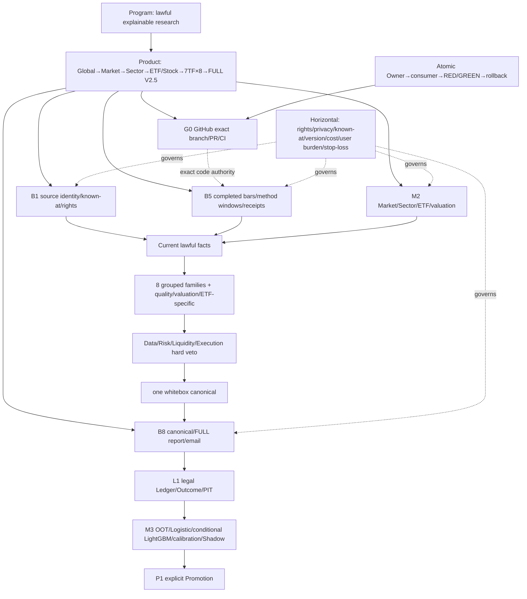

# STOCK_DSA GitHub基线与总路线

> 本文是现有DSA机器图、执行合同和运行证据的维护者视图，不是新的Source、策略、数据库、调度器或报告权威。机器可读不变量见 `docs/stock-dsa-stage-baseline-v1.json`；真实状态仍由GitHub代码、CI、运行回执和合法数据证据决定。

<!-- CURRENT_MASTER_CONTROL_START -->
## 当前控制页：GitHub连续性、五级目标与完整研究边界（2026-11-02）

CONTROL_ID = STOCK_DSA_MASTER_ROUTE_20261102_GITHUB_CONSOLIDATION_INDUSTRY_VALUATION_VOLUME_PHASE_NARROW_CHAN
SOURCE_AUTHORITY = Project Source恰好8个唯一Owner，01/05为v3.543；旧v3.542已删除。文件内“prepared”切点由三次最新物理清单覆盖。
GIT_AUTHORITY = 唯一允许仓库 `https://github.com/leeningzzu/dsa-market-research.git`。远端已接受基线仍为 feature HEAD `37e453f729b0f9ad1cec6d8b27457916b7982142` / CI95；包含本文的候选提交必须从Git运行时解析，普通non-force推送到现有feature，PR #31保持Draft/Open/未merge，禁止main直推、force、rebase、squash、手动CI dispatch、Settings/Secrets及旧/private仓库复活。
IMMUTABLES = 原机器图149628字节/775边/SHA256 `b4f69f76807ac44bc0fea1a03f9aa38484b6083ca574a3699220b0564ac55aed`；原V2.5 125919字节/SHA256 `039ca6394baf9cf39494cc29f512802b114c8227f8c965723197a8df4b9de823`。本文与Stage JSON仅为当前状态投影，不替代二者。
PROOF_COLUMNS = Code/contract、Actual source/method execution、Product admission、Original V2.5 delivery、Ledger/PIT/model五列独立验收，禁止相互替代。

### 0.1 父目标和五级纵向对齐

- **Program**：合法known-at数据→白盒证据→相关性去重与Data/Risk/Liquidity/Execution veto→唯一canonical→完整Report/Email→合法Ledger/Outcome/PIT→独立OOT/校准/Shadow/Promotion；不自动交易、不保证收益。
- **Product**：Global→A股市场/宽度/资金/信用/估值→行业分类/行业RS/行业估值→ETF专项与个股质量估值→月/周/日/60m/30m/15m/5m八族证据→同一canonical和不压缩V2.5。
- **Lane**：G0 GitHub；B1来源/权利；B5方法/动态窗口；M2市场/行业/ETF；B8完整报告；L1合法记录/PIT；M3模型校准；P1显式Promotion。兄弟Lane不互相冒充。
- **Milestone**：当前Milestone是把长期本地59路径候选（55个已跟踪修改＋4个新文件）整合为一个可审查GitHub feature提交，包含行业估值路由、量价阶段候选、窄Chan、此前7×8/数据准入/报告消费者及本轮跨消费者修复，并由自然CI决定远端接受；不等于Product72或邮件已完成。
- **Atomic**：每个变更必须绑定现有Owner、实际消费者、独立RED、合法nontrigger、回滚路径和proof ceiling；禁止只登记方法名或只更新文档。



### 0.2 当前实现与明确边界

| 能力 | 当前实现 | 不得夸大的边界 |
|---|---|---|
| 7周期K线/均线/量价/成本/动量/形态 | 完成bar、XSHG会话、5m→15/30/60m、日→周/月、逐方法动态窗口和递归稳定；39日合法返回后缀不再被错误丢弃 | 共享抓取最长窗不等于所有方法READY；未完成bar、缺单位/来源/权利保持MISSING/UNKNOWN |
| 八证据族 | 56/56格有Owner/回执/来源或missingness；REGIME共享一次；Stock benchmark RS与ETF peer RS按完整bar网格对齐 | 八族不是八票；同源同摆动去重；测试/结构完整不等于真实56 READY |
| 行业估值 | `P_INDUSTRY/E_BASKET` dated classification→行业family→九条既有估值路线；成熟消费/工业、高成长科技、银行、保险、周期资源、公用事业、REIT、亏损早期成长、ETF各用不同primary method并保留cross-check | 禁止公司名猜行业、通用PE兜底、假定倍数、ETF套股票ROE/PE；分类、盈利状态、known-at或Product缺失即拒绝 |
| 吸筹/洗盘/出货/派发 | 量价Supply与已确认Structure共同产生 `ACCUMULATION/WASHOUT/DISTRIBUTION/MARKUP/MARKDOWN_CANDIDATE`；仅严格回执的派发/下跌候选可形成去重风险veto | 只表示可观察候选，不识别“主力”、机构意图或操纵；吸筹/洗盘候选不能自动升级BUY，单一量价代理不能重复投票 |
| Chan窄适配 | 复用已确认Pivot/Swing，生成confirmed fractals、strokes及三笔价格重叠候选；prefix replay冻结几何核心并允许合法失效生命周期更新 | 明确 `NOT_FULL_CZSC`；未实现包含处理/线段/完整中枢/背驰/买卖点交易器；无独立行动、strategy、learning或data-rights authority |
| 全球/大盘/市场/行业 | Treasury源和部分沪深300/货币/行业分类已有source-observed证据；BLS权利合同有效但当前host曾403 | Global18/CNMarket18/Sector7未形成同一as-of完整Product；指数价格不能替代宽度/成分/资金/信用/估值 |
| 个股质量与估值 | 九条估值公式、质量/财务输入合同和行业路由已接 | 当前600519财务revision、绝对债务/资产、正式估值假设及交叉核验仍非完整Product |
| ETF专项 | 价格、peer RS与技术链已有；ETF路由强制独立 | NAV/IOPV、份额、折溢价、点差、跟踪、篮子与底层指数估值未全准入 |
| V2.5 | 原件不变；逐方法/逐周期数值仅在Product+回执+来源同时通过后显示 | 旧84周期空数值邮件已撤销；结构数、HTML生成或Source-observed DETAIL不能冒充FACT_READY/实收 |

### 0.3 方法与机器状态

- 43个方法Profile当前为 **30个EXISTING_REUSED / 13个DEFERRED_WITH_OWNER_AND_REENTRY**；原始声明对34，有效执行对154。DISTRIBUTION与CHAN从延期目录进入daily实际Owner，但不新增相关指标投票。
- 仍延期：RISK_REWARD、ADX_DMI、BOLLINGER、KDJ、OBV_ADL、MFI、VWAP、AVWAP_VOLUME_PROFILE、WAVE、ETF_SPECIFIC、GLOBAL、BREADTH、PROBABILITY等。延期不等于遗漏，也不能为提高完成率强行实现。
- 本次新增焦点链61/61 PASS；43个相关模块完整回归1340/1340 PASS（580.56秒，2个第三方/收集警告）。测试使用忽略目录中的进程级可选依赖等价桩，不安装依赖、不改变生产代码或断言；自然PR CI仍是独立远端门禁。
- Product仍为0/72。用户对内部研究运行的授权已经记录，不再要求重复上传许可；但软件/API说明、运行授权和上游数据Product/storage/training/redistribution权利是不同事实。当前GitHub整合不发起Provider读取，不改变Product计数。

### 0.4 横向门禁与Role Review

| Role | 当前结论 | 半径/处置 |
|---|---|---|
| PRODUCT | 7TF×8、行业估值、量价阶段、窄Chan工程消费者本地PASS；完整Global/Market/Sector/Quality/ETF事实与FACT_READY邮件STOP | CROSS_LANE；KEEP DSA、NARROW合法数据纵向切片 |
| DATA_MODEL | 动态窗口/来源身份/known-at规则成熟；Product0/72、财报vintage与ETF专项仍缺 | CROSS_LANE；REUSE现有Identity/Rights-v2，禁止伪造 |
| PROCESS_CONSUMER | 已修复39日后缀丢失、RS仅端点对齐、行业估值无路由、阶段证据无canonical consumer、Chan仅目录延期 | LANE_RECURRENT；RED→GREEN并扫描同族 |
| AUTHORITY_CURRENTNESS | Source8 v3.543 PASS；公共origin/base HEAD明确；当前候选必须commit/push/natural CI后才是远端候选 | INSTANCE→LANE；exact Git永远优先本文 |
| ENVIRONMENT | WebCodex Local可用；测试使用进程内可选依赖桩；一次诊断漏设LiteLLM本地成本表导致超时GET，未产生模型调用或事实消费 | INSTANCE_ONLY；所有后续入口预先设置本地cost map |
| ADAPTER_INTERFACE | 继续用现有DSA Pipeline/Registry/Factor/V2.5；Chan为窄适配器 | KEEP/WRAP；不安装CZSC/LEAN/OpenBB/Freqtrade整栈 |
| DEV_TOOLING | 焦点61/61与相关模块1340/1340 PASS；远端自然CI待执行 | LOCAL_PASS/REMOTE_OPEN；禁止改Golden、xfail或用进程桩冒充完整运行时安装 |
| USER_BURDEN | Source旧542已由用户删除；后续确定性Git/测试机器执行 | SIMPLIFY；不再要求许可原文、Token或日志搬运 |

CURRENT_ROUTE_STILL_WORTH_CONTINUING = YES_KEEP_ONLY_DSA
INSTRUCTIONS_UPDATE_DECISION = NO_DELTA_KEEP
SOURCE_UPDATE_DECISION = v3.543保持当前；本次GitHub material closure完成后再按实际commit/CI生成一对新checkpoint，不机械更新八份Source。

### 0.5 GitHub是跨模型连续性的唯一代码基线

任何后续模型必须按以下顺序重入：

1. 读取 `AGENTS.md`、本文、`docs/stock-dsa-stage-baseline-v1.json`；核对Project Source恰好8个Owner及01/05 IDs。
2. 实际执行 `git remote get-url origin`、HEAD/tree、branch/worktree/staged/untracked；只接受公共 `leeningzzu/dsa-market-research.git`。本文中的SHA/CI只代表写入时观察，不能替代新鲜Git证据。
3. 核对现有feature/PR #31/main与自然CI；禁止从目录名、旧私有display name或旧Chat选择权威。
4. 先消费当前方法/数据/产品/交付/学习五列证明，再选择唯一下一步；CLOSED/SUPERSEDED不重跑。
5. 任何新能力必须同时进入：生产Owner、实际consumer、负例、合法nontrigger、本文状态投影、机器JSON和自然CI。只更新聊天/Source/方法目录不算完成。
6. 禁止main直推、force/rebase/squash、手动CI重跑、PR正文改写、Settings/Secrets、merge/release，除非有新的精确授权。

UNIQUE_NEXT_STEP = 本地相关回归已PASS；把当前明确59路径allowlist作为一个英文原子commit普通推送现有feature，观察自然PR CI；不merge。CI结果成为GitHub当前候选证据。随后返回B1/M2同一as-of全域事实和原V2.5数值叶，不再机械增加指标或重做7×8。
<!-- CURRENT_MASTER_CONTROL_END -->

## 1. GitHub是后续工程基线

所有可继续开发的能力必须进入当前公共仓库的功能分支，经Pull Request和阻断CI后才可成为新基线。禁止把长期能力只留在本地WIP、聊天摘要或Project Source中；也禁止直接把未经CI验证的WIP推到 `main`。

每个新基线至少绑定：

- exact origin、父提交、候选提交和工作树状态；
- 机器图与V2.5不可变哈希；
- 已执行测试及明确未执行测试；
- Program→Product→Lane→Milestone→Atomic纵向归属；
- B1权利、B5方法、B8交付、History/PIT和Promotion横向门禁；
- 已证明、未证明、失败谱系、回滚方式和唯一后继关口。

## 2. 三层机器图，不相互冒充

1. **接受的原始图**：149628字节、775边及其SHA；保持不可变。
2. **代码投影**：26研究义务、43方法Profile、13策略绑定、7×8=56技术格、76数据对象；由现有Registry编译，不另建图数据库。
3. **运行回执**：来源、完成bar、known-at、单位、复权、方法Owner和消费者真实执行；只有该层能够把某项状态推进到READY/PARTIAL。

静态计数用于防止能力被删除；不能证明数据已经取得、指标已经收敛或产品已经交付。

## 3. 五级纵向目标

| 层级 | 目标 | 当前证明上限 |
| --- | --- | --- |
| Program | 合法known-at数据→白盒证据→唯一canonical→完整交付→合法Outcome/PIT→独立校准→Shadow→Promotion | 不自动交易，不保证收益 |
| Product | Global→A股市场/行业→ETF/股票→七周期/基本面/估值/风险→FULL Report/Email | 单股票技术证据不能替代市场、ETF和基本面 |
| Lane | B1权利、B5来源/方法、B8完整报告、History/PIT、模型与Promotion | 各Lane独立门禁，不平均抵消 |
| Milestone | 当前控制页0.9指定一个有界纵向切片；下文dated milestone为历史证据 | 不等于43方法全部READY |
| Atomic | 复用既有Owner、消费者、测试和负例的最小改动 | 不建第二套Shell/DB/Registry/Report |

## 4. 阶段基线

### G0 GitHub基线

功能分支、PR、required CI和可回滚提交身份。只有PR阻断检查通过并显式合并，才形成后续开发基线。

### HISTORICAL — G0 PR #30 Linux CI六项失效修复时检查点（2026-10-16）

> 后继证据：PR30随后已在CI 38890306259通过并合并为main b32570b1；以下“尚未证明/等待”描述仅属于当时修复候选，不是当前PR状态。新的M2候选分支必须另验PR/CI。

实际GitHub CI日志为6348 passed / 6 failed / 30 deselected，四组为Backtest真实回测重取、轻量股票名的扩展日线窗口、原生零外部模型P0、市场复盘History/通知诊断三项。它们全部在本地原入口复现RED；根因分类为五处B1未证明存储许可的历史正向预期与一处旧2023-06-01的硬编码起点。不能把新B1存储VETO降级以制造History/Ledger、也不能让旧起点缩短七周期MACD/RSI窗口。

当前改动限定在四份既有原生测试，不改业务代码或不变量：真实隔离临时SQLite中的Backtest合成来源明确为test；轻量名称预取仍不触发实时名查询但要求独立交易日历/方法窗口起点2015-02-02而非已废弃2023-06-01；MarketReview来源未获存储许可时必须保持History 0行，仍保留in-memory通知诊断成功、失败原因和原query_id贯通；零外部模型P0使用真实typed+hash的合成日K验证原生确定性canonical为PROVEN/WAIT，但严格History first-write拒绝未知权利，PredictionLedger不得被调用，隔离库只允许合成StockDaily/基本面测试快照、0外部请求/0通知/0结果文件/0 PIT/0模型训练。旧P0预期的严格Ledger+History正向不可恢复，直到独立GRANT；保留原有独立合法非严格隔离Ledger测试，不修改其真实语义。

自然回归：Backtest/Prefetch 77/77、MarketReview及runtime/lock 48/48、B1/PIT/Flywheel 136/136、Stage Baseline/Pipeline 48/48 =309/309 selected native, windows-local only。受影响四份测试的原生消费者均执行，未删测、xfail或降低失败场景；类型化合成价格准入仅限温度隔离sqlite、不读取Secret、不安装依赖、不使真实供应商历史可写。**尚未证明 GitHub Linux全仓CI通过**：普通功能分支小提交push后必须由同一PR的自然check重新执行，不能因本地PASS直接merge。后续父主线仍为Global/CN/sector/ETF known-at与七周期共同canonical/FULL Report，不为修测试废除风控。Role Review: USER_DISCOVERED_CI_FAILURE=TRUE_POSITIVE、EARLIEST_DETECTION_POINT=PR阻断CI原生日志；PROCESS_CONSUMER/LANE_RECURRENT（旧测试合同）和DATA_MODEL（B1门禁）区分记录，CURRENT_ROUTE_STILL_WORTH_CONTINUING=YES；不扩大Instructions，Source更新等待PR明确检查点。

### B1 来源权利与第一写入

未知第三方数据的存储、训练和再分发权利继续在StockDaily、AnalysisHistory和Ledger最早写入点拒绝。类型化来源身份、qfq、内容SHA和PIT标记都不能代替许可。

### B5 七周期来源和方法

完成月/周/日/60m/30m/15m/5m bar、方法特定动态窗口、递归稳定性、来源身份、MA/MACD/RSI/结构等确定性输出，以及逐周期缺失状态。READY只属于对应方法和输入，不自动获得交易资格。

### B8 唯一canonical与完整无发送报告

76项义务、支持、反证、风险、触发/失效、时点和七周期逐指标明细进入同一FULL Report、Email和HTML。正式报告Email必需，Telegram可选；真实SMTP和收件客户端另验。

### M2 多资产known-at（ACTIVE）

优先接入可独立核验的A股指数/宽度、行业分类与相对强度、ETF价格/NAV/份额/折溢价/跟踪/篮子时点。它们只能确认、降级、否决或保持UNKNOWN，不能单独升级BUY。

运行检查点1已经落到现有DSA：CN MarketReview会在A股复盘中有界读取上证指数已完成日线来源，经原MarketReview→DailyMarketContext→REGIME严格方法回执→76数据对象，把 **M_INDEX_CURRENT** 从UNKNOWN推进为**仅来源身份PARTIAL**。真实2026-10-15只读回执已验证，指数值本身仍不作为独立策略投票；历史MarketReview缓存不得重获该同进程来源准入。

检查点2选择ETF价格而非机械推进指数/宽度：现有BaoStock对 sh.000001 的5m真实探测返回0行，不能用股票5m链伪造 M_INDEX_BARS；受控运行环境又缺AkShare，M_BASIC_BREADTH无法取得真实全A快照，禁止仅凭合成数据晋升。相反，510300在BaoStock实际共同可得日2026-10-15返回430根1d与10个完整交易日480根5m，同provider/qfq/CNY；严格ETF MTF回执现在只把 **E_PRICE_1D / E_PRICE_5M** 推进为来源级PARTIAL，5m量额单位、数据权利、历史PIT仍UNKNOWN，股票财务对象NOT_APPLICABLE，E_NAV_IOPV/E_SHARES/E_PREMIUM/E_SPREAD/E_TRACKING/E_BASKET继续UNKNOWN。下一原子优先补ETF专属NAV/份额/折溢价中可合法known-at的一项，或在AkShare运行能力合法恢复后回到市场宽度；不新增并行ETF技术Shell。

### M2大盘指数5m来源（候选，未晋升算法／策略）

在既有BaoStock sh.000001 5m接口真实返回0行后，对照AKShare公开的 index_zh_a_hist_min_em 东财近期指数分钟接口（https://github.com/akfamily/akshare/blob/main/docs/data/index/index.md）。2026-10-16一次受控直接只读请求实际收到1536根5m、32个完整交易日，8月26日至10月16日。随后同接口以及新适配器的独立实际请求遇到 RemoteDisconnected；不能宣称新适配器已稳定生产取数，更不能将32个交易日补为DSA当前约67日的分钟递归历史。

路线与成熟复用：RULE_EXISTS=YES，CURRENT_CAPABILITY=BaoStock指数已完成日K+原XSHG 5m聚合，DONOR=AKShare仅其指数接口查询结构，KEEP/WRAP=原data_provider最薄Python标准库索引请求；没有AKShare安装、新数据库、第二调度器或另建指数报告。src/services/intraday_bar_service 仍负责完成会话和5m→15m/30m/60m确定性半日内聚合，原DailyMarketContext/Factor/Registry/Report仍是唯一消费者。适配只允许精确sh.000001/sh.000300，单次有界HTTPS、禁止跳转、XSHG 48根完整会话、错指数/乱序/重复/改价/提前观测/混合hash一律拒绝。来源身份标记UNCLASSIFIED，fqt=0请求不等于独立证明响应真实复权基础，分钟量／额单位、货币、数据存储/训练/再分发权利及历史PIT全部UNKNOWN。

生产CN MarketReview只在当前或前一完整交易日有界读取：失败作为合法nontrigger，不改原完整文本。只有当前进程的源收据可进入DailyMarketContext；history缓存、伪造GRANTED/READY、变session/散列不可重新准入。REGIME严格方法回执通过后，76对象中的M_INDEX_BARS仅为来源级PARTIAL；M_INDEX_CURRENT另有BaoStock日线来源，M_BASIC_BREADTH继续UNKNOWN。完整Report／Email／HTML保留M_INDEX_BARS的PARTIAL、源身份、未准入原因及76项义务，Market Light、唯一canonical与买入动作都不变。新原生13项以及相邻市场/通知/聚合等模块受控回归；本地测试是合成Eastmoney接口形状，不能取代实况访问与收件端证明。

Role Review：Program长期DSA单一Research Shell→Product Global/CN市场/行业/ETF/股票全材料→Lane M2源准入及B5七周期→Milestone指数5m来源执行收据→Atomic标准库薄适配与原消费者投射。反对视角包括：上游网络不稳、32<67分钟动态历史、指数月/周/日与四分钟period的源/复权不完全同一口径、无独立历史Universe、未入门的数据权利、15m/5m短周期不应升级交易。借鉴LEAN市场时段合并及Warm Up交易禁入，Freqtrade recursive-analysis及lookahead-analysis的多起点比较/未来信息拒绝，只复用模式，不安装任何并行指标/调度/数据库。CURRENT_ROUTE_STILL_WORTH_CONTINUING=YES，但 FULL_7TF_INDEX_METHODS=NOT_PROVEN；下一合法阶段仍须独立真实长窗口、单位、known-at/PIT或切换行业/ETF已可核证据，不机械重试东财。

### L1 合法Ledger/Outcome/PIT

只有来源权利、as-of/vintage、完整机会分母、未触发/未成交、成熟label和不可变字节均合法时才进入。

### M3 模型和校准

白盒Logistic先行；仅有样本外增量才LightGBM；walk-forward、独立校准、冻结Shadow和显式Promotion分离。

## 4A. 跨Chat父路线复核与两条反馈链（2026-10-17）

### 已证明与未证明，禁止静态合同替代执行

本节是既有路线的执行澄清，不是第二份Source/策略/机器图。复核基点：远端main为b32570b1（PR30已绿色合并）；功能分支9531baf1含指数分钟源与六阶段合同，尚不可把该分支称作main生产能力。Project物理01/05仍v3.468，生成的v3.469不是已安装Owner；代码当前性取exact Git，旧State的WIP SHA不能倒退工程基线。历史资料/个人上下文/当前8 Source和本轮exact code可交叉核验，但未取得所有旧Chat全文或原R019包，不宣称无遗漏的全历史审计。

重要纠偏：compile_screening_funnel_contract只编译设计和既有权重，不实际执行所有六阶段。43方法恰归15组不是统计相关性已检验，注册所有56技术格不是逐资产真实运行通过。旧文中把ATR/ROC/OBV统作同类、或要求粗筛结果永远等于全Universe深析，均不得成为实施验收依据。纯缓存/批量化/重构必须保持结果等价；候选截断改变研究样本，需要记录budget_deferred与拒绝样本漏选审计，不能伪称零漏选。

### 父目标与横纵对齐

Program=合法、白盒、可验证可回滚的股票/ETF研究与独立概率校准，不自动交易/保证收益。Product=Global→大盘→行业→ETF/个股的完整研究和共同canonical/Report/Email。Lane=B1来源权利、B5四资产类七周期方法、M2独立市场/行业/ETF证据、B8无损交付、L1合法历史结果、M3验证校准，互不冒充。Milestone须以真实Owner→消费者→负例→运行回执关闭；Atomic一次关闭一个有界语义缺口。横向始终保留Data/Risk/Liquidity/Execution veto、版本/available_at、隐私/版权、同根复发/用户负担；任何好分数不能抵消veto。

### 四条价格链都要七周期，但不建立四套引擎

| 对象 | 必须绑定的价格对象 | 七周期工作方式 | 不能替代的非价格证据 |
|---|---|---|---|
| 大盘 | 明确全市场/大盘/成长等代表指数及price/total-return口径 | 每个代表指数共用日→周/月、5m→15/30/60m和相同方法Owner；不能只看指数涨幅 | 全市场宽度、成分分母、资金/杠杆、估值风险补偿 |
| 行业 | 正式行业/板块指数及分类版本；合成指数另需当时成员/权重/算法 | 同一七周期引擎；分类标签不能生成行业OHLCV，ETF不能无声明冒充行业指数 | 行业内宽度/中位收益、成员当时归属、行业盈利和估值 |
| ETF | 基金交易价格、份额单位、除权/分红处理与跟踪标的 | 与股票共用完成bar/原生指标，但ETF策略/peer专属 | NAV/IOPV、份额、溢价点差、跟踪、篮子；ETF自身无股票ROE龙头语义 |
| 个股 | 证券身份、同口径价量、公司行动vintage | 月周环境、日setup、60m桥接、30m结构、15m确认、5m时点 | 质量成长/适用估值、财报公告版本、行业/同业RS |

不是每个Universe成员每天计算7×43，也不是每一财务/宏观序列都重采样成七周期。粗筛用合法廉价日线/横截面；代表市场与行业共享计算；股票和ETF各自capped候选进入共同deep engine，SPECIFIED_CODES不经过粗筛也不占AUTO配额。产品上限stock/ETF各10、重点各3，实际运行预算可更小，允许0，禁止凑数。

### 动态窗口：复用已有方法编译器，不再新建registry

现有src/core/pipeline.py::_current_daily_window_plan与_current_intraday_window_plan已经按MethodWindowProfile/原方法Owner反推请求。要继续补的是逐资产/来源能力以及实际返回的消费，而非再造同名规划器。最小契约为：asset+instrument+timeframe+method+algorithm/config+target_completed_bar → formula minimum / recursive comparison / structure context / confirmation requirement →同source/复权的共享请求→actual returned bars/session coverage→每个方法独立readiness→已确认事件/失效→canonical消费者。固定rolling、递归初始化、形态变长、事件anchor、抓取跨度、持仓/label horizon、存储保留、OOT切分必须分开。

历史可得性要区分滚动保留天数、固定日期底、每次分页上限、快照only、可回补及独立vintage。分页只能突破单次响应上限，不能突破源端真实保留底。更换来源不能静默拼接口径；合法缓存才可持久化，不为累计长窗口绕过B1。

例如前序东财32个完整交易日1536根5m，可聚合512根15m、256根30m、128根60m。它不满足某些60m递归比较，却不能因此抹除合法短周期MA或已收敛方法；也不能因为5m够长就把60m判READY。67日只是当前某组方法要求的最大共享请求目标，不是所有指标统一最低窗。对数据足够但递归数值/状态仍不稳，仅有界扩窗；无变化/同类失败达到Stop-Loss则保留MISSING，不修改算法容差迎合输出。

### 两条产品因果链与工程旁路

链A（研究/交付）：合法known-at事实→确定性八族/七周期→相关来源与摆动去重→策略条件和独立veto→唯一canonical→原FULL Report/Email。LLM只能解释。

链B（第二条结果反馈链）：当时可存的TAKE/PASS/WAIT/否决/未触发/未成交记录→不可变Journal/Ledger→成熟Outcome及冻结label/成本/执行规则→PIT样本→滚动时间外验证→白盒Logistic→有增量才LightGBM→独立校准→冻结Shadow→显式Promotion。没有合法存储授权和当时版本，不以当前回补财报/行情形成历史PIT，不只采成功邮件。不得让未来Outcome改变当时窗口、特征、样本名单或确认时点。胜率之外须看净期望、回撤、周转/滑点、覆盖及校准；不同预测期限分别定义label。

工程反馈（旁路，不取代链B）：actual stage counts/latency/error/预算跳过→Expected-vs-Observed→TP/FP/FN/LATE+earliest detection→实例/同Lane/跨Lane根因→KEEP/REUSE/SIMPLIFY/DELETE/BYPASS/RECOMPOSE/NARROW/DEFER→独立负例和合法nontrigger。耗时、HTTP错误不能作为市场成功label；历史查询变快不等于胜率提高。自动诊断只生成待审证据，不自动改阈值/策略/模型或训练/Promotion。

### 本轮实际消费者增量

screening.pipeline.screen实际写入ScreenResult.execution_receipt，普通ScreeningService响应和AUTO资产路由响应携带同一元数据。不是在编译器中写几个布尔值自证完成：每次经过snapshot、host_prefilter、snapshot_filter、daily_enrichment、daily_filter、shortlist、post_analysis、selection才记录数量/monotonic耗时；未请求NOT_REQUESTED，提前返回未到达NOT_REACHED；日线预算跳过与实际失败、过滤排除分开；DSA completed/failed/skipped在最终截断前统计。

此回执仅run-local聚合执行元数据，不含原始行情/私人名单/Secret，不新增表或scheduler，不改变分数、候选排序及canonical。provider_http_request_count=None，因为高层fetch调用数不能证明HTTP重试/缓存次数。completed DSA调用也不证明全部7周期READY。当前AUTO便宜筛选入口明确不做DSA deep，后续core pipeline才深析，因此在此回执中NOT_REQUESTED合法；跨core的7TF逐方法manifest join、fatal exception回执、精确网络计数、全Universe耗时与漏选率仍未证明。不得把本轮工程计数宣称为第二链已获得可训练样本。

本轮实际验证：新增4个原入口用例先4 RED（缺execution_receipt），最窄实现后GREEN；进一步检验真实DSA post-analyzer状态和daily全拒绝；AUTO最终provenance曾丢弃内部回执，独立RED后在现有出口保留stock/etf execution_receipts，最终新增7项PASS，另4项既有AUTO测试同次PASS。现有Builtin Screening 31项和Stage Baseline 6项通过。宽范围Screening API+Selection共119项中114 PASS/5 FAIL；5项为旧hotspot/缺AkShare与deadline/fallback路径，完整环境等价性未证明，不能改断言/安装依赖或声称全套CI绿。该宽测与一次模块导入曾意外尝试东财/LiteLLM公开metadata请求并失败，属于F2测试隔离缺口，不是新授权实源/模型调用；最后定向验证已对外部socket拒绝。后续不重跑同族失败碰运气，当前功能分支新PR/Linux CI仍需独立确认。

### 增量价值与非冗余信息

八证据族保留为组织视图。相关性还需至少按经济问题、原始数据、同一摆动/事件、周期职责区分，不能一个粗group抹掉全部维度。ATR/realized volatility用于风险尺度和归一化，ROC描述方向速度，MACD/RSI描述动量位置；CMF/OBV/MFI是量价代理，不等于纯价格动量。Chan分型/笔/中枢属结构，背驰与同摆动MACD背离去重，买卖点还需确认/执行；普通pivot不能冒充Chan。VCP/杯柄/均线粘连可能同一收缩证据，但有效突破和后续回踩是不同已确认事件。统计聚类、消融、条件增量和学习权重只在训练/验证折内做，不能看最终测试集选择指标。

### 分阶段最小路线与退出证据

| 次序/阶段 | 当前最小产物 | 主Owner | 退出证据/不能冒充 |
|---|---|---|---|
| 0 工程续接 | 当前branch/main/PR身份、原图/V2.5、Source checkpoint | Git + 01/05 | exact SHA及绿色CI；不是源数据/收益通过 |
| 1 本轮运行回执 | 八个实际筛选seam计数/耗时，零候选/预算/失败非触发 | screening.pipeline/models/service | 原入口RED→GREEN、排序不变；不是自动调参 |
| 2 四对象来源覆盖 | 代表指数、一个行业指数、ETF、个股的1d/5m可得窗+权利/单位/口径manifest | data_provider + existing identities | 一份真实正例/失败反例/无请求nontrigger；先核缺源，不新装整湖 |
| 3 方法/窗口接线 | 同一asset/timeframe/method实际requested/returned/required/stability/status加入已有MTF诊断 | core pipeline + MTF/Registry | prefix与多起点稳定；不会全因60m缺口取消5m方法 |
| 4 资产选择闭环 | 市场/行业RS宽度与ETF专属资格+候选短名单→同一7TF/canonical | MarketStructure/Screening/Factor | 前后代码、cap、错资产/veto负例；不全市场重跑深析 |
| 5 确认/执行 | 30m结构、15m确认、5m时点、点差/限价/可成交条件 | existing structure/pattern/MTF | origin/confirmed/available/invalidation逐根；不把当前信号当成交 |
| 6 第二链 | 合法完整机会分母、Outcome/PIT/成本、Logistic/OOT/校准 | existing History/Ledger/Outcome | 许可+合法写读+独立时间验证；B1仍HOLD则不训练 |

这些是有依赖的工作队列而非所有Lane强制串行：一个指数分钟源失败不阻止个股/ETF的合法证据、行业标签核验或工程旁路；但缺某策略required source时该策略动作仍WAIT/PASS，不能拿兄弟Lane成功覆盖。

### 本轮成熟项目重查：模式转化而非整栈安装

- DSA自身/已接受AlphaSift派生：保留实际粗筛、cap、post状态、服务响应，是本次唯一代码复用入口。
- LEAN：交易时段聚合/动态Universe资源释放、warm-up与交易隔离，转成原XSHG聚合/prefix负例；不安装交易引擎。官方：https://www.quantconnect.com/docs/v2/writing-algorithms/consolidating-data/consolidator-types/market-hour-aware-consolidators
- Freqtrade：不同startup末端数值比较；lookahead未触发信号会漏检，对横截面排名还需保留同一Universe不能只切成单资产。官方：https://www.freqtrade.io/en/stable/recursive-analysis/ 和 https://www.freqtrade.io/en/stable/lookahead-analysis/
- CNEquity：coverage_start/end、history_mode/backfill_source、snapshot-only不造历史、分钟按需派生；当前官网跟随开发树且可能不同已冻结v0.12，文档窗口不是实测授权/完整数据。本轮未升级或安装。官方：https://rootsunc.github.io/CNEquity/datasets/catalog/
- OpenBB：QueryParams/Data分离及字段验证转为现有typed adapter审计，软件schema不证明源语义或权利。官方：https://docs.openbb.co/odp/python/developer/standardization
- Qlib：财报publication/period/revision PIT模式；文档PIT有季度/年度设计边界，不是通用分钟数据许可。当前仅未来实验donor。官方：https://qlib.readthedocs.io/en/latest/advanced/PIT.html
- CZSC：FX/BI/ZS和多级别bar/event，当前1.0 Rust与旧0.9 Python不同，窄adapter必须固定版本/许可/ABI并逐根重放，不接第二交易器。官方：https://github.com/waditu/czsc
- scikit-learn：相关特征的单变量permutation可低估整体信息，借鉴成组消融/训练折内聚类而非用随机拆分证明金融收益。官方：https://scikit-learn.org/stable/auto_examples/inspection/plot_permutation_importance_multicollinear.html

Role Review结论：PRODUCT=四资产七周期和第二链保持OPEN；PROCESS_CONSUMER=静态清单→实际执行计数本轮改进；DATA_MODEL=时点/单位/授权/label继续硬门禁；DEV_TOOLING=功能分支自然回归再push；AUTHORITY_CURRENTNESS=实际Git领先已安装State需paired checkpoint。USER_DISCOVERY=TRUE_POSITIVE（再次提醒七周期不可被粗筛或工程复盘替代），EARLIEST_DETECTION_POINT=前次六阶段合同说明，AUTO_RETROSPECTIVE_BEFORE_USER_REMINDER=NO仍保留历史；本轮主动找到的边界纠正不构成系统长期自动复盘稳定证明。R019 exact包未恢复，仅复用已在03/Factor授权的父目标/consumer、成熟复用/负例、自然回归/净负担三个模式。CURRENT_ROUTE_STILL_WORTH_CONTINUING=YES；不更新Instructions、不建新Shell，更新必要01/05 checkpoint而非全8份重写。

## 5. 粗筛→细选运行时机器图、证据组合与权重

本节是原775边接受图和Registry的**派生运行投影**，不是第二套机器图、评分器或Product权威。机器可读版本由 `compile_screening_funnel_contract()` 与 `stock-dsa-stage-baseline-v1.json` 共同锁定。

```text
L0 Source Admission
  provider / symbol / completed_bar / known_at / available_at / units / rights
        │  不满足即UNKNOWN或拒绝；不计分
        ▼
L1 Global / Market / Sector Permission
  Global只确认/降级/失效；Market/Sector风险可veto，不独立升级BUY
        │
        ▼
L2 Asset Coarse Filter（便宜、全Universe）
  Stock: currentness + daily bar + liquidity + market + sector classification
  ETF:   currentness + daily bar + liquidity/spread + market + peer universe
        │  只缩小Universe，不跑全量7TF
        ▼
L3 Asset Fine Rank（仍为确定性排序，不是概率）
  Stock: sector/peer RS → quality/growth → valuation → daily setup → execution
  ETF:   peer RS → liquidity/spread → NAV/premium/tracking → shares flow → daily setup
        │
        ▼
L4 Bounded Deep Analysis + 7TF Overlay
  M/W context → D setup → 60/30 bridge/structure → 15/5 confirmation/timing
        │  严格MTF receipt + canonical binding；只对Top-K执行
        ▼
L5 Correlation Dedup + Hard Veto + Canonical + FULL Report/Email
        │
        ▼
Legal Outcome / PIT / OOT / Calibration / Shadow / Promotion
```

### 5.1 邮件中的八个技术证据组如何组合

八组继续保留，但每组只回答一个主问题；质量成长、估值、ETF专属和Data/Risk/Liquidity/Execution不硬塞进八组，而作为独立横向Lane。

动态邮件的阅读顺序固定为：canonical结论 → 市场/行业许可 → 股票质量/估值或ETF专属 → 八证据族 → 七周期职责摘要 → 相关性去重 → Data/Risk/Liquidity/Execution veto → 触发/失效 → 来源/时点/权利/缺失。顺序变化不得删除材料；V2.5静态接受原件保持字节不变。

| 证据组 | 主问题 | 主要内容 | 去重规则 |
| --- | --- | --- | --- |
| REGIME | 当前环境是否许可 | Global、Market Regime、Breadth、Sector Phase | 绿灯只能确认，红灯可降级/否决 |
| TREND_RS | 相对方向是否有优势 | 相对强度、MA排列、斜率、粘连/释放 | MA和RS同属trend_price，不逐指标投票 |
| SUPPLY | 供需/量价是否确认 | 相对量、方向量、CMF、派发风险 | 与OBV/MFI等共属volume_pressure |
| COST | 当前价格相对成本如何 | rolling cost、VWAP/AVWAP/Volume Profile | 同属price_volume_cost，只保留一份独立贡献 |
| STRUCTURE | 已确认价格结构是什么 | pivot、breakout/retest/invalidation、Chan分型/笔/中枢、Wave Shadow | 普通pivot、Chan、Wave共属confirmed_price_swing；Chan不得冒充额外一票 |
| MOMENTUM | 同一摆动的动量/波动怎样 | MACD、RSI、ROC、ATR、confirmed divergence、扩展oscillator | 同一摆动共属same_swing_momentum，最多一份独立贡献 |
| PATTERN | 是否形成可执行形态 | VCP、杯柄、双底、flat/tight base、candlestick | 收缩/底部形态共属price_contraction，不能多次加分 |
| MTF | 各周期职责是否一致 | 月周环境、日setup、60/30结构、15/5确认时点 | 不重算前七组，不作为第九票，只做层级一致性修正 |

Chan仅作为窄 `ChanFeatureAdapter`：分型/笔/中枢进入STRUCTURE；背驰若基于同一摆动进入MOMENTUM相关组；买卖点只有完成bar、confirmed_at、invalidation和算法版本齐全时才可进入PATTERN/MTF。一般pivot不得改名为Chan。

### 5.2 当前实际权重，而不是永久权重

权重分三层：

1. **Gate无权重**：Data/Risk/Liquidity/Execution和hard veto不可被平均抵消；失败直接拒绝或降级。
2. **当前可执行的确定性权重**：只有现有严格7TF overlay已获准使用数值；context `+1.25/-2.0`，daily setup `+1.75/-2.5`，60/30 bridge-structure `+0.75/-1.0`，15/5确认仅在高/日周期支持时 `+0.25`，不利时 `-0.5`，总边界 `[-6,+4]`。
3. **学习型权重**：质量、估值、行业、ETF专属及各技术族的最终权重，必须等合法Outcome/PIT、walk-forward和独立OOT后再由白盒Logistic估计；在此之前只使用优先级、family cap和coverage，不把启发式分数叫胜率或概率。

MISSING/UNKNOWN不是0分好消息，也不是负分；它们是`zero vote + lower coverage`。同一correlation group无论有多少指标最多贡献一次。报告必须同时显示score和coverage，避免缺失数据通过归一化反而提高排名。

### 5.3 是否必须先把七周期全部跑通才讨论筛选

不需要等待43种方法和56格全部READY才设计粗筛/细选；但**任何被消费的周期/指标必须先有完成bar、来源身份、方法回执和readiness**。当前顺序是：

- 先用便宜L0-L3缩到有限候选；
- 只对Top-K执行7TF深析；
- 已READY方法进入相应family，MISSING/UNKNOWN原样保留；
- 当月RSI、15m确认、5m时点或单位未来补齐时，自动增加coverage，不改机器图或另建评分器。

因此“先完成全部7TF再筛选”会浪费资源；“没验证7TF就先加权”同样错误。正确做法是**架构先定、方法逐项准入、权重后验校准**。

### 5.4 数据库到指标的最简实现链

```text
Provider Adapter
→ Standard Data Object（OpenBB式Query/Data标准化思想）
→ content identity / known_at / available_at / rights
→ completed-bar aggregation（LEAN式market-hours-aware consolidation）
→ method-specific dynamic window
→ recursive stability / lookahead negatives（Freqtrade模式）
→ 8-family evidence + correlation dedup
→ asset route + hard veto
→ canonical / FULL Report / Email
→ 仅合法Ledger/Outcome/PIT（Qlib思想延后复用）
```

当前不安装OpenBB、LEAN、Freqtrade、Qlib或CZSC作为并行运行栈；只吸收标准化、coarse/fine、warm-up、recursive/lookahead、PIT和窄Chan adapter模式。原DSA继续拥有数据、调度、Registry、canonical、Report和History权威。

## 6. 当前路线选择

**主路线选择M2多资产known-at，而不是先把17个延期技术方法全部开发完。**

理由：七周期核心来源、方法回执和完整展示已经形成一条可运行链；父产品最大的当前缺口是市场、行业、ETF和基本面时点，而不是再增加同源相关指标。继续批量堆指标会提高局部深度，却无法关闭市场许可、资产适用性和完整产品门禁。

七周期现在也进入现有筛选消费者，但只位于便宜L1/L2之后的有界DSA候选短名单：`snapshot/daily prefilter → capped DSA deep analysis → strict MTF role overlay → final selection`。它不让全市场逐标的无界执行七周期，也不新增第二筛选器。严格MTF回执和canonical binding通过后，七个周期按四个职责组消费，而不是七票相加：

- `context`：月线长期环境与周线主趋势；
- `setup`：日线主要setup；
- `bridge_structure`：60m桥接与30m主结构；
- `confirmation_timing`：15m确认与5m时点。

筛选偏好限定在 -6至+4，低周期只能在context和daily setup均支持时给最多+0.25确认，任何canonical PASS/hard veto都阻断正向加分。MISSING/UNKNOWN不转换为中性票，来源回执过期、候选代码错配或签名篡改均为0分拒绝。真实2026-10-15完整七周期只读验收中，600519因月周与日线动量不利、但60m/30m和15m/5m局部支持，筛选偏好为-3.75；510300在周/日及60m/30m不利、仅5m局部支持时触及-6下限。两者均未被低周期反转；这证明层级消费有效，不代表该数值是永久或全市场结论。

技术指标继续作为有界子Lane：

- 月线RSI：只有合法更长历史和交易日历可证明时推进；
- 15m确认、5m执行时点：必须绑定已确认结构及执行veto；
- 分钟量/额单位：来源未证明前不得消费量价方法；
- ADX/DMI、Bollinger、KDJ、OBV/ADL、MFI、VWAP/AVWAP、Chan/Wave：只有产品消费者或独立增量触发时重入。

## 7. 横向对齐

- **B1**：来源和持久化权利为不可抵消veto。
- **B5**：指标只由确定性Owner生成；LLM/Email不生成数值、价位、概率或意图。
- **市场/行业/ETF**：资产专属语义和known-at身份独立；ETF不套股票估值/Leader逻辑。
- **B8**：同一canonical生成FULL Report/Email；图片、短摘要和聊天回复不能替代正式报告。
- **History/PIT**：未来结果只进入Outcome/label，不倒灌历史证据。
- **Promotion**：绑定exact代码、数据、特征、策略、模型和校准器，并需显式批准。

## 8. 成熟项目复用边界

复用顺序保持：DSA现有能力→DSA upstream→接受的成熟Sibling→窄Donor→最薄Adapter。

- Freqtrade类递归启动/未来信息检测：只借鉴多起点敏感性和lookahead负例，不复用交易动作或第二策略框架。
- LEAN类warm-up和多分辨率聚合：只借鉴按实际订阅分辨率规划历史、避免循环重复History，不并存第二数据调度器。
- AlphaSift类级联筛选：只复用本仓已有的便宜L1/L2→有界L3深析顺序；七周期不在全市场入口重复计算，也不允许LLM文字参与排名。
- Qlib：仅在合法PIT数据集、rolling实验和独立模型阶段使用。
- CZSC：仅可作为窄ChanFeatureAdapter；普通pivot不得冒充Chan笔段/背驰。
- AlphaEvo/LightGBM：仅在有独立样本外增量的冻结Shadow阶段。

## 9. 防退化和防返工

CI必须同时保护：

- 43方法、26复用/17延期、13策略绑定、56技术格、76数据对象；
- V2.5和接受机器图哈希；
- Email必需/TG可选、无自动交易、无LLM数值生产；
- 类型化来源身份、错时点、未知单位、未来回填、资产错配和渠道替代负例；
- 七周期同一方法Owner数值进入FULL Report/Email/HTML，无第二计算；
- 七周期筛选必须严格MTF回执+canonical binding、四职责组、-6/+4边界、低周期不可独立升级；
- 旧golden不得为候选输出降低，MISSING/UNKNOWN不得补造。

失败按PRODUCT、DEV_TOOLING、AUTHORITY_CURRENTNESS、ENVIRONMENT、ADAPTER_INTERFACE、PROCESS_CONSUMER、DATA_MODEL分类；同Gate连续两次同类失败即Parent-Route Re-entry，不机械追加补丁。

## 10. GitHub发布节奏

1. 冻结当前父提交与回滚包；
2. 建功能分支，不直接推main；
3. 本地运行AI governance、syntax、flake8、deterministic和offline suite；
4. 提交一组可解释的baseline commit；
5. 推送分支并建立PR；
6. 等待ai-governance、backend-gate、docker-build等阻断检查；
7. 记录CI结果、未证明项和Role Review；
8. 显式merge后，该commit才成为新的Production GitHub基线。

历史PR #30已绿色合并为main b32570b1。当前feat/stock-dsa-m2-source-gates-v1中的指数源、筛选合同和运行回执属于后继候选；截至本控制页核验，不能引用旧PR30的绿灯替代新分支PR/Linux CI。功能分支push不等于CI执行，更不等于main已包含该能力。PR30曾经历通知/历史测试修复，其失败与修复记录保留于dated章节，不再充当当前待办。

M2候选实现可以在同一已推送功能分支继续，并持续以小提交同步GitHub；但未merge的分支能力只能称候选基线，不能冒充main/Production。任何本地WIP、ZIP、Project Source或聊天结论都不能替代GitHub分支、CI与最终merge形成的工程基线。
